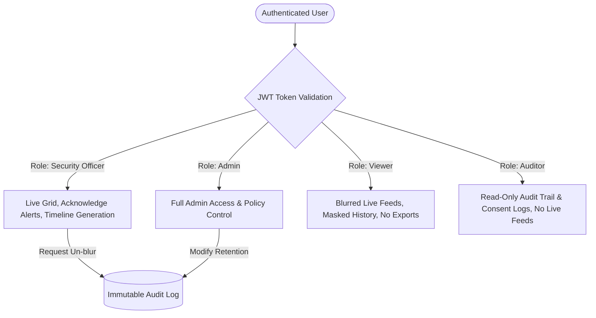

# EcoLifyBuddy — Privacy Policy & DPDP Act 2023 Compliance Specification

> **Product:** EcoLifyBuddy  
> **Slogan:** An AI-Based CCTV Intelligence System for Visitor Identification, Activity Tracking, and Safer, Cleaner Communities  
> **Jurisdiction:** India — Digital Personal Data Protection Act, 2023 (DPDP Act 2023)  
> **Status:** Active Standard Policy (Phase 1 Baseline)

---

## 1. Overview & Purpose Limitation

EcoLifyBuddy is an edge and cloud CCTV intelligence system designed for physical premises safety, access audit, visitor tracking, and community cleanliness monitoring. 

In accordance with the **Digital Personal Data Protection Act, 2023 (DPDP Act 2023)** of India, personal data (including digital video frames, appearance embeddings, and metadata) is processed **strictly for specified, lawful, and reasonable purposes**:
1. Preventing unauthorized intrusions into private/restricted zones.
2. Maintaining a verifiable, timestamped access log of commercial visitors (delivery personnel, technicians, domestic staff, service vendors).
3. Expediting incident investigation via forensic search without manual review of unrelated footage.
4. Monitoring municipal and community cleanliness compliance (legacy module).

Personal data is **never** monetized, sold, repurposed for behavioral advertising, or shared with third parties without explicit legal compulsion or data principal consent.

---

## 2. Categories of Data Collected

| Data Category | Data Elements | Classification | Storage Location | Default Retention |
| :--- | :--- | :--- | :--- | :--- |
| **Video Streams** | Raw CCTV video feeds from registered IP/webcam streams | Digital Media | Processed in-memory; ephemeral ring buffer | Discarded unless tied to an event |
| **Appearance Re-ID Embeddings** | 512-dimensional numerical vectors representing clothing color, texture, and torso geometry (OSNet) | Pseudonymous Biometric-Adjacent Feature Vector | Neon Postgres (`pgvector` table with HNSW index) | 30 days (configurable: 30/60/90) |
| **Facial Embeddings (Optional)** | 512-d ArcFace / InsightFace representations | Sensitive Biometric Data | Disabled by default (`FACE_RECOGNITION_ENABLED=false`). Stored only upon signed consent | 30 days or revoked upon consent withdrawal |
| **Event Metadata** | Timestamp, Camera ID, Zone, Track ID, Carried Objects, Dwell Time | Activity Logs | Neon Postgres (`events` table) | 30 days (configurable) |
| **Incident Thumbnails & Clips** | Bounding box crops (5s pre-event, 10s post-event) | Evidence Records | Local encrypted volume (`/clips/`, `/snapshots/`) | Purged with parent event |
| **System Audit Logs** | User ID, Role, Action (Search, Export, Un-mask, View), Target ID, Reason | Compliance Metadata | Neon Postgres (`audit_logs` table) | **Immutable (minimum 365 days)** |

---

## 3. Privacy by Design: Core Principles

### 3.1. Anonymisation & Face/Body Blurring by Default
* All live multi-camera viewports, recorded event thumbnails, and forensic timeline crops apply a **Gaussian blur / pixelation mask** over human faces and identifying contours by default.
* The standard **Viewer** role only sees blurred feeds and masked identifiers.
* Un-masking (de-anonymisation) requires an **Admin** or **Security Officer** role with a **mandatory written justification** (e.g., active FIR, incident ticket number), which is permanently written to the immutable audit log.

### 3.2. Appearance Re-ID vs. Facial Biometrics
* By default, EcoLifyBuddy identifies returning individuals using **non-biometric visual Re-Identification (OSNet)**:
  * Re-ID analyzes coarse appearance traits (clothing colors, patterns, silhouette, carried accessories).
  * Re-ID vectors cannot be reverse-engineered to reconstruct an individual's face.
* Facial recognition is strictly locked behind:
  1. An explicit environment flag: `FACE_RECOGNITION_ENABLED=true`.
  2. A verified consent record in the `consents` table signed by the data principal (e.g., regular building staff or enrolled vendors who opted in for contactless gate clearance).

### 3.3. Role-Based Access Control (RBAC)
Access is enforced cryptographically using JSON Web Tokens (JWT) with fine-grained role claims:



### 3.4. Immutable Audit Trail
Every system action involving personal data is captured in an immutable audit ledger:
* **Who:** User identity and role.
* **When:** UTC timestamp.
* **What:** Exact query parameters, visitor ID looked up, or video clip streamed.
* **Why:** Stated operational or security justification.
* **Origin:** Client IP address and session token signature.

---

## 4. Data Principal Rights (Under DPDP Act 2023)

In accordance with Chapter III of the DPDP Act 2023, individuals whose image or presence is processed by EcoLifyBuddy have the following rights:

### 4.1. Right to Access Information
Any visitor or resident may request a summary of personal data maintained in the system (e.g., timestamps of visits associated with their vehicle or verified profile). Authorised administrators can generate a verifiable data report.

### 4.2. Right to Correction and Erasure ("Right to be Forgotten")
* Individuals have the right to request deletion of non-incident historical logs.
* EcoLifyBuddy provides an administrative right-to-delete endpoint:
  ```http
  DELETE /api/v2/visitors/{visitor_id}/purge
  ```
  Executing this permanently deletes:
  * All associated appearance embeddings from `visitor_embeddings`.
  * All associated cropped facial representations and consent references.
  * Associated evidence thumbnails and video clips from disk.
  * Replaces the visitor profile label with `[REDACTED_DATA_PRINCIPAL_REQUEST]`.
  * Preserves an anonymized entry in the audit log proving the erasure was completed.

### 4.3. Right of Grievance Redressal
Each deployment of EcoLifyBuddy must specify a designated **Data Protection Officer (DPO)** or premises security manager whose contact details must be made available on the `/about` view and physical premises notices.

---

## 5. Data Retention & Automatic Purge Policy

Data must not be retained longer than necessary for the purpose for which it was collected.

1. **Configurable Retention Window:**
   The parameter `RETENTION_DAYS` in `.env` (default: **30 days**) governs the lifecycle of active visitor data.
2. **Scheduled Purge Daemon:**
   A background maintenance job runs daily at `02:00 UTC` to delete:
   * Event rows older than `RETENTION_DAYS`.
   * Unmatched or transient visitor embeddings with no activity in `RETENTION_DAYS`.
   * Video clips and thumbnail snapshots older than `RETENTION_DAYS`.
3. **Audit Exemption:**
   Security audit logs (`audit_logs`) are exempt from standard 30-day deletion and are retained for a minimum of **365 days** to comply with Indian cybersecurity regulations (CERT-In directives).

---

## 6. Security Safeguards

* **Transport Encryption:** TLS 1.3 / HTTPS for all web dashboard communication and RTSP-over-TLS where supported by camera hardware.
* **Authentication Security:** Passwords hashed with `Argon2id` or `bcrypt` with high work factor. JWT tokens expire within 60 minutes with secure HTTP-only cookies.
* **Storage Encryption:** Postgres data at rest encrypted via Neon transparent encryption. Video clips and snapshots stored on encrypted volumes (BitLocker on Windows, LUKS on Linux).
* **Network Isolation:** Camera streams should operate on a dedicated VLAN isolated from public internet access.

---

## 7. Operational Contact

For queries regarding privacy practices or to exercise data rights under the DPDP Act 2023:
* **System Custodian:** Designated Premises Administrator / Security Controller
* **Privacy Officer Contact:** `privacy@organisation.org`
* **Technical Inquiries:** Refer to repository documentation and source code at `c:\LIL`.
